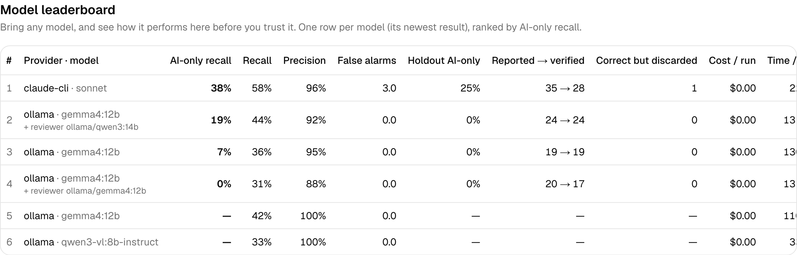

# Benchmark

How the agent is measured, and every result so far. The README shows the headline numbers; this
page keeps the full history (results are never deleted or rewritten) and what each run taught.
Per-bug detail and the reasons behind misses are in [MISS_ANALYSIS.md](MISS_ANALYSIS.md).

## Method

`npm run bench` runs the agent 3× on the buggy shop and once on the clean shop, then 2× on the
buggy **holdout app** and once on its clean build. Each report is matched to the app's
`bugs.json` (page first, then a judge model; every decision is saved), and the result stores
the scores with the provider, model, judge and commit.

Two recall numbers, because they answer different questions:

- **AI-only recall** counts only the planted bugs that need judgement (a wrong total, an
  accepted invalid email, a layout that breaks on a phone). The free deterministic checks
  (console errors, failed requests, broken links, accessibility) find the others whatever the
  model, so this is the number to compare models by.
- **Recall** counts all planted bugs: what a user of the product gets.

**Why a holdout app.** The agent's prompt and tools are developed while watching it work on the
demo shop, so a good shop score could mean the agent learned the shop. `apps/demo2` is a
room-booking app with six bugs of the same *kinds* (an API failure, an unlabelled field, a wrong
total, accepted invalid input, a double submit, a mobile overflow) and different specifics.
Nothing is ever tuned against it, and a unit test fails if anything from either app's
`bugs.json` appears in the prompt or tool descriptions. A holdout score close to the shop score
means the techniques are general.

The judge (`JUDGE_PROVIDER` / `JUDGE_MODEL`) is kept the same while the agent model changes, so
two models are graded by the same judge. `bench --rescore` re-matches the saved runs of the
latest result: it keeps the commit the runs were made on and records its own commit separately.

## All results

Shop: 3 buggy runs + 1 clean run each; holdout: 2 buggy + 1 clean.

| Provider · model | AI-only recall | Recall | Precision | False alarms / clean run | Cost / run | Time / run | Judge | Commit |
|---|---|---|---|---|---|---|---|---|
| ollama · qwen3-vl:8b-instruct (local, 16 GB Mac) | 0% | 33% | 100% | 0.0 | $0.00 | 335 s | the model itself | e8d3a24 |
| ollama · gemma4:12b (local) | 13% | 42% | 100% | 0.0 | $0.00 | 522 s | the model itself | e78a2ca |
| ollama · gemma4:12b, 1200 s budget (local) | 13% | 42% | 100% | 0.0 | $0.00 | 1101 s | the model itself | 18e1975 |
| ollama · gemma4:12b, run-2 agent, shop (local) | 0% | 33% | 100% | 0.0 | $0.00 | 490 s | gemma4:12b (pinned) | 8453aea |
| ollama · gemma4:12b, run-2 agent, **holdout** (local) | 0% | 33% | 100% | 0.0 | $0.00 | | gemma4:12b (pinned) | 8453aea |
| ollama · gemma4:12b, after the D52 fixes, shop (local) | 4% | 36% | 100% | 0.0 | $0.00 | 501 s | gemma4:12b (pinned) | 21e5669 |
| ollama · gemma4:12b, after the D52 fixes, **holdout** (local) | 0% | 33% | 100% | 0.0 | $0.00 | | gemma4:12b (pinned) | 21e5669 |
| claude-cli · Sonnet, **one run only** (owner's plan) | 13% | 42% | 100% | not measured | $0.00 | 302 s | gemma4:12b (pinned) | 0124950 |
| ollama · gemma4:12b, run 3 (replay fix + charter reminder), shop (local) | 8% | 39% | 100% | 0.0 | $0.00 | 1075 s | gemma4:12b (pinned) | 984755e |
| ollama · gemma4:12b, run 3, **holdout** (local) | 0% | 33% | 100% | 0.0 | $0.00 | | gemma4:12b (pinned) | 984755e |
| claude-cli · Sonnet, run 3, shop (owner's Pro login) | **38%** | **58%** | 96% | 3.0 (real unplanted bugs) | $0.00 | 222 s | gemma4:12b (pinned) | a8a6d13 |
| claude-cli · Sonnet, run 3, **holdout** | **25%** | **50%** | 100% | 1.0 | $0.00 | | gemma4:12b (pinned) | a8a6d13 |
| ollama · gemma4:12b, run 4 (expected vs. actual), shop (local) | 8% | 39% | 100% | 0.0 | $0.00 | 1156 s | gemma4:12b (pinned) | a0af21e |
| ollama · gemma4:12b, run 4 (everything; shop signed in, 13 bugs) | 0% | 31% | 94% | 0.0 | $0.00 | 1277 s | gemma4:12b (pinned) | b114b43 |
| ollama · gemma4:12b, run 4, **holdout** | 0% | 33% | 89% | 0.0 | $0.00 | | gemma4:12b (pinned) | b114b43 |
| ollama · gemma4:12b + **gemma4:12b reviewer**, run 5, shop | 0% | 31% | 88% | 0.0 | $0.00 | 1312 s | gemma4:12b (pinned) | da16f0e |
| ollama · gemma4:12b + gemma4:12b reviewer, run 5, **holdout** | 0% | 33% | 100% | 1.0 | $0.00 | | gemma4:12b (pinned) | da16f0e |
| ollama · gemma4:12b + **qwen3:14b reviewer** (text-only), run 5, shop | **19%** | **44%** | 92% | 0.0 | $0.00 | 1319 s | gemma4:12b (pinned) | e160a34 |
| ollama · gemma4:12b + qwen3:14b reviewer, run 5, **holdout** | 0% | 33% | 89% | 0.0 | $0.00 | | gemma4:12b (pinned) | e160a34 |
| ollama · gemma4:12b alone, run 5 (before/after replay, list reminder), shop | 7% | 36% | 95% | 0.0 | $0.00 | 1302 s | gemma4:12b (pinned) | a72290d |
| ollama · gemma4:12b alone, run 5, **holdout** | 0% | 33% | 100% | 0.0 | $0.00 | | gemma4:12b (pinned) | a72290d |
| claude · claude-sonnet-5-5 (API) | not run: needs an API key and budget | | | | | | | |

## What each run taught

**Run 2.** With the new agent, Gemma 4 12B lost its one AI bug (it wrote the
"$NaN" price in a note instead of reporting it) and found "Save does nothing" once, but replay
threw that report away (fixed generically, D52). The holdout scored like the shop, so there is
no sign of shop-specific tuning. Sonnet (one run through the `claude` CLI, so not a benchmark)
explored much better: it reported a wrong cart total and the broken "Save changes" as well as
the "$NaN" price, but replay dismissed the first two; that is the next thing to fix
(see [PROGRESS.md](PROGRESS.md)). The bottleneck has moved from the model to verification.

**Run 3.** With replay fixed (it no longer throws correct reports away) Sonnet finds 7
of the 8 judgement bugs on the shop at least once and 2 of 4 on the holdout it was never tuned
on. Gemma 4 12B now uses the charter's techniques and reaches most bug states, but rarely
recognises them; that, not exploration or verification, is its limit
([MISS_ANALYSIS.md](MISS_ANALYSIS.md)). Sonnet's "false alarms" on the clean builds are real behaviour that
isn't in the planted list (an empty name is saved, a reload empties the cart).

**Run 4.** An expected-vs-actual check flags the steps where what the agent predicted didn't
happen, but Gemma explained most of them away (23 flagged, 19 dismissed). The shop gained a bug
behind a login (13); Gemma found "Save changes does nothing" twice and the one-screenshot judge
rejected it both times, which led to run 5's verification.

**Run 5.** Verification that measures a change (not one screenshot) keeps the "Save
changes does nothing" bug Gemma used to lose, and a reminder to open an item of every list the
crawl found gets the agent to the order pages. A local 14B reviewer on the flagged steps then
recognises what the 12B explorer reaches: the shop's judgement-only recall goes 0% → 7% (Gemma
alone) → 19% (with the reviewer), and bug 13 is found for the first time. The holdout stays at
0% for every local setup, so the reviewer isn't the default yet (the rule: it must lift the
holdout); a stronger model is the next measurement.

**Note on the first three rows.** AI-only recall for them is computed from their per-bug results (bug 9, "$NaN" price, was
the only AI bug found, by Gemma in 3 of 3 runs); they predate the holdout app. Bugs 1–4 were
found in every run by the deterministic checks.

