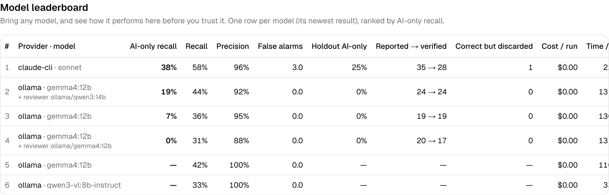

# Benchmark

How the agent is measured, and every result so far. The README shows the headline numbers; this
page keeps the full history (results are never deleted or rewritten) and what each run taught.
Per-bug detail and the reasons behind misses are in [MISS_ANALYSIS.md](MISS_ANALYSIS.md).

## Method

`npm run bench` runs the agent 3× on the buggy shop and once on the clean shop, then 2× on the
buggy **holdout app** and once on its clean build. Each report is matched to the app's
`bugs.json` (page first, then a judge model; every decision is saved), and the result stores
the scores with the provider, model, judge and commit.

Two recall numbers, because they answer different questions:

- **AI-only recall** counts only the planted bugs that need judgement (a wrong total, an
  accepted invalid email, a layout that breaks on a phone). The free deterministic checks
  (console errors, failed requests, broken links, accessibility) find the others whatever the
  model, so this is the number to compare models by.
- **Recall** counts all planted bugs: what a user of the product gets.

**Why a holdout app.** The agent's prompt and tools are developed while watching it work on the
demo shop, so a good shop score could mean the agent learned the shop. `apps/demo2` is a
room-booking app with six bugs of the same *kinds* (an API failure, an unlabelled field, a wrong
total, accepted invalid input, a double submit, a mobile overflow) and different specifics.
Nothing is ever tuned against it, and a unit test fails if anything from either app's
`bugs.json` appears in the prompt or tool descriptions. A holdout score close to the shop score
means the techniques are general.

**Benchmark versions.** Every result records the version of the demo apps it was measured on.
**v1** is runs 1–6. **v2** (run 7) fixed, in both builds, four unplanted behaviours that run 6's
agents reported: the profile's "Recent orders" listed orders "My orders" never showed; a
double-clicked "Add to cart" added twice; the holdout accepted check-in dates in the past and
dates outside a room's availability. The planted bugs didn't change. Scores of different versions
aren't directly comparable (v2 removes real behaviour that v1 counted as false alarms), so the
leaderboard keeps them apart.

The judge (`JUDGE_PROVIDER` / `JUDGE_MODEL`) is kept the same while the agent model changes, so
two models are graded by the same judge. `bench --rescore` re-matches the saved runs of the
latest result: it keeps the commit the runs were made on and records its own commit separately.

## All results

Shop: 3 buggy runs + 1 clean run each; holdout: 2 buggy + 1 clean. Cost is what was charged; run 6 rows add
the API-equivalent estimate ("est."), computed from the CLI's token counts at list price (D88).

| Provider · model | AI-only recall | Recall | Precision | False alarms / clean run | Cost / run | Time / run | Judge | Commit |
|---|---|---|---|---|---|---|---|---|
| ollama · qwen3-vl:8b-instruct (local, 16 GB Mac) | 0% | 33% | 100% | 0.0 | $0.00 | 335 s | the model itself | e8d3a24 |
| ollama · gemma4:12b (local) | 13% | 42% | 100% | 0.0 | $0.00 | 522 s | the model itself | e78a2ca |
| ollama · gemma4:12b, 1200 s budget (local) | 13% | 42% | 100% | 0.0 | $0.00 | 1101 s | the model itself | 18e1975 |
| ollama · gemma4:12b, run-2 agent, shop (local) | 0% | 33% | 100% | 0.0 | $0.00 | 490 s | gemma4:12b (pinned) | 8453aea |
| ollama · gemma4:12b, run-2 agent, **holdout** (local) | 0% | 33% | 100% | 0.0 | $0.00 | | gemma4:12b (pinned) | 8453aea |
| ollama · gemma4:12b, after the D52 fixes, shop (local) | 4% | 36% | 100% | 0.0 | $0.00 | 501 s | gemma4:12b (pinned) | 21e5669 |
| ollama · gemma4:12b, after the D52 fixes, **holdout** (local) | 0% | 33% | 100% | 0.0 | $0.00 | | gemma4:12b (pinned) | 21e5669 |
| claude-cli · Sonnet, **one run only** (owner's plan) | 13% | 42% | 100% | not measured | $0.00 | 302 s | gemma4:12b (pinned) | 0124950 |
| ollama · gemma4:12b, run 3 (replay fix + charter reminder), shop (local) | 8% | 39% | 100% | 0.0 | $0.00 | 1075 s | gemma4:12b (pinned) | 984755e |
| ollama · gemma4:12b, run 3, **holdout** (local) | 0% | 33% | 100% | 0.0 | $0.00 | | gemma4:12b (pinned) | 984755e |
| claude-cli · Sonnet, run 3, shop (owner's Pro login) | **38%** | **58%** | 96% | 3.0 (real unplanted bugs) | $0.00 | 222 s | gemma4:12b (pinned) | a8a6d13 |
| claude-cli · Sonnet, run 3, **holdout** | **25%** | **50%** | 100% | 1.0 | $0.00 | | gemma4:12b (pinned) | a8a6d13 |
| ollama · gemma4:12b, run 4 (expected vs. actual), shop (local) | 8% | 39% | 100% | 0.0 | $0.00 | 1156 s | gemma4:12b (pinned) | a0af21e |
| ollama · gemma4:12b, run 4 (everything; shop signed in, 13 bugs) | 0% | 31% | 94% | 0.0 | $0.00 | 1277 s | gemma4:12b (pinned) | b114b43 |
| ollama · gemma4:12b, run 4, **holdout** | 0% | 33% | 89% | 0.0 | $0.00 | | gemma4:12b (pinned) | b114b43 |
| ollama · gemma4:12b + **gemma4:12b reviewer**, run 5, shop | 0% | 31% | 88% | 0.0 | $0.00 | 1312 s | gemma4:12b (pinned) | da16f0e |
| ollama · gemma4:12b + gemma4:12b reviewer, run 5, **holdout** | 0% | 33% | 100% | 1.0 | $0.00 | | gemma4:12b (pinned) | da16f0e |
| ollama · gemma4:12b + **qwen3:14b reviewer** (text-only), run 5, shop | **19%** | **44%** | 92% | 0.0 | $0.00 | 1319 s | gemma4:12b (pinned) | e160a34 |
| ollama · gemma4:12b + qwen3:14b reviewer, run 5, **holdout** | 0% | 33% | 89% | 0.0 | $0.00 | | gemma4:12b (pinned) | e160a34 |
| ollama · gemma4:12b alone, run 5 (before/after replay, list reminder), shop | 7% | 36% | 95% | 0.0 | $0.00 | 1302 s | gemma4:12b (pinned) | a72290d |
| ollama · gemma4:12b alone, run 5, **holdout** | 0% | 33% | 100% | 0.0 | $0.00 | | gemma4:12b (pinned) | a72290d |
| claude-cli · **claude-haiku-5-5** agent, run 6, shop (pinned ID; est. API $0.093/run) | 26% | 49% | 81% | 0.0 | $0.00 | 246 s | gemma4:12b (pinned) | 123e23e |
| claude-cli · claude-haiku-5-5 agent, run 6, **holdout** (est. $0.060/run) | **62%** | **75%** | 100% | 0.0 | $0.00 | | gemma4:12b (pinned) | 123e23e |
| claude-cli · **claude-sonnet-5-5** agent, run 6, shop (pinned ID; est. API $1.44/run) | **33%** | **54%** | 84% | 2.0 (real unplanted behaviour) | $0.00 | 196 s | gemma4:12b (pinned) | 0079304 (agent code 123e23e) |
| claude-cli · claude-sonnet-5-5 agent, run 6, **holdout** (est. $1.68/run) | **75%** | **83%** | 100% | 1.0 (real) | $0.00 | | gemma4:12b (pinned) | 0079304 |
| ollama · gemma4:12b + **claude-sonnet-5-5 reviewer** (claude-cli), run 6, shop (est. $0.010/run) | 11% | 38% | 100% | 0.0 | $0.00 | 1118 s | gemma4:12b (pinned) | 0366f15 (agent code 123e23e) |
| ollama · gemma4:12b + claude-sonnet-5-5 reviewer, run 6, **holdout** (est. $0.054/run) | 0% | 33% | 100% | 0.0 | $0.00 | | gemma4:12b (pinned) | 0366f15 |
| ollama · gemma4:12b + **claude-opus-5-5 reviewer** (claude-cli), run 6, shop (est. $0.068/run) | 7% | 36% | 100% | 0.0 | $0.00 | 1143 s | gemma4:12b (pinned) | 19ffd92 |
| ollama · gemma4:12b + claude-opus-5-5 reviewer, run 6, **holdout** (est. $0.213/run) | 0% | 33% | 80% | 0.0 | $0.00 | | gemma4:12b (pinned) | 19ffd92 |
| claude-cli · claude-haiku-5-5, run 7 **benchmark v2** baseline, shop (est. $0.104/run) | 33%* | 54% | 100% | 2.0 | $0.00 | 273 s | gemma4:12b (pinned) | 3276fab |
| claude-cli · claude-haiku-5-5, run 7 benchmark v2 baseline, **holdout** (est. $0.101/run) | 75% | 83% | 93% | 0.0 | $0.00 | | gemma4:12b (pinned) | 3276fab |
| claude-cli · claude-haiku-5-5, run 7 benchmark v2 + shop **critical flows**, shop (est. $0.105/run) | 30% | 51% | 89% | 1.0 | $0.00 | 276 s | gemma4:12b (pinned) | 8aa5746 |
| claude-cli · claude-haiku-5-5, run 7 benchmark v2, **holdout** (no flows there; est. $0.099/run) | 62% | 75% | 93% | 1.0 | $0.00 | | gemma4:12b (pinned) | 8aa5746 |
| claude-cli · claude-sonnet-5-5, run 7 benchmark v2 + shop critical flows, shop (est. $1.65/run) | **48%** | **64%** | 91% | 2.0 (real behaviour) | $0.00 | 241 s | gemma4:12b (pinned) | dde46e0 |
| claude-cli · claude-sonnet-5-5, run 7 benchmark v2, **holdout** (est. $1.35/run) | 50% | 67% | 100% | 0.0 | $0.00 | | gemma4:12b (pinned) | dde46e0 |
| **claude (API)** · claude-haiku-5-5, run 8 benchmark v2, shop (real charge; 2026-11-17) | 33% | 54% | 100% | 0.0 | **$0.016** | 144 s | gemma4:12b (pinned) | b5aaf9b |
| claude (API) · claude-haiku-5-5, run 8 benchmark v2, **holdout** | 62% | 75% | 100% | 1.0 | $0.013 | | gemma4:12b (pinned) | b5aaf9b |
| claude-cli · claude-haiku-5-5, run 8 benchmark v2 + shop critical flows **+ recheck** (4 shop runs; est. $0.108/run; 2026-11-17) | 39% | 58% | 100% | 3.0 (real behaviour) | $0.00 | 276 s | gemma4:12b (pinned) | 626f25c |
| claude-cli · claude-haiku-5-5, run 8 benchmark v2, **holdout** (no flows there; est. $0.099/run) | 75% | 83% | 100% | 0.0 | $0.00 | | gemma4:12b (pinned) | 626f25c |
| claude-cli · claude-haiku-5-5, run 8 benchmark v2, **N3 part A** (4 shop + 4 holdout runs; est. $0.105/run; 2026-11-17) | 39% (25–55) | 58% | 92% | 3.0 (real behaviour) | $0.00 | 272 s | gemma4:12b (pinned) | 447c7fc |
| claude-cli · claude-haiku-5-5, run 8 N3 part A, **holdout** | 56% (33–77) | 71% | 100% | 0.0 | $0.00 | | gemma4:12b (pinned) | 447c7fc |
| claude-cli · claude-haiku-5-5, run 8 benchmark v2, **N3 part B** (same settings; est. $0.106/run) | 42% (27–58) | 60% | 95% | 1.0 (real behaviour) | $0.00 | 271 s | gemma4:12b (pinned) | 447c7fc |
| claude-cli · claude-haiku-5-5, run 8 N3 part B, **holdout** | 69% (44–86) | 79% | 96% | 0.0 | $0.00 | | gemma4:12b (pinned) | 447c7fc |
| **N3 pooled (A + B): 8 shop + 8 holdout runs** | **shop 40% (30–52), holdout 62% (45–77)** | 59% / 75% | | 2.0 / 0.0 | | | | 447c7fc |
| claude · claude-sonnet-5-5 (API) | not run (run 8: no Sonnet, Opus or Fable runs) | | | | | | | |
| **claude (API)** · claude-haiku-5-5, benchmark v2 after the **six check improvements** (PRs #20–#25), shop (real charge; 2026-11-23) | 37% (22–56) | 56% | 74% | 2.0 (1 new metadata finding + 1 real behaviour) | $0.017 | 154 s | gemma4:12b (pinned) | 92fc566 |
| claude (API) · claude-haiku-5-5, six check improvements, **holdout** | 75% (41–93) | 83% | 88% | 1.0 (the new metadata finding) | $0.013 | | gemma4:12b (pinned) | 92fc566 |

## Six check improvements (2026-11-23): regression against run 8's API row

Same command, settings and judge as run 8's API row (`LLM_PROVIDER=claude`, Haiku 5.5, 40 steps,
480 s, judge gemma4:12b; shop 3 buggy + 1 clean, holdout 2 buggy + 1 clean), after the layout,
meta, console-warning, keyboard-probe, success-without-request and CSS-visibility changes
(D105–D110). Result `f3c996c4`, total charge $0.107 for the 7 runs.

| | Run 8 API (b5aaf9b) | After (92fc566) |
|---|---|---|
| Shop AI-only recall | 33% (9/27) | 37% (10/27; Wilson 22–56%) |
| Shop recall | 54% | 56% |
| Shop false alarms per clean run | 0.0 | 2.0: the new metadata finding (1) + "cart emptied on reload" (1, real clean-build behaviour reported in run 8 too) |
| Shop precision | 100% | 74% |
| Holdout AI-only recall | 62% (5/8) | 75% (6/8; Wilson 41–93%) |
| Holdout recall | 75% | 83% |
| Holdout false alarms per clean run | 1.0 | 1.0: the new metadata finding |
| Holdout precision | 100% | 88% |
| Charge per run | $0.016 / $0.013 | $0.017 / $0.013 |

- **Recall:** within noise (the intervals overlap widely). The planted "'Save changes' does
  nothing" (shop bug 8) was found in 1 of 3 runs, as before, and stayed verified: the new pixel
  check measured 0 changed pixels around the button. No report matching a planted bug was
  discarded.
- **False alarms:** the only new deterministic finding on either clean build is the
  metadata check (neither demo app has Open Graph tags, a canonical link or an
  apple-touch-icon: true of the apps, not planted). Layout, console warnings, axe
  best-practice and the keyboard probe added nothing on the clean builds. Without the metadata
  category: shop 1.0, holdout 0.0.
- **Precision:** lower because the new deterministic checks report real but unplanted things
  on the buggy builds (the metadata finding, about two axe best-practice findings per shop
  run). Agent reports that matched nothing didn't increase.

## Deep mode, first evaluation: demo shop (run 9, 2026-11-24)

One deep run on the buggy shop (`75a366f0`) and one on the clean shop (`e2f17518`), signed in
as the benchmark's shop runs are. Sonnet 5.5 at effort high through the Claude Agent SDK on the
owner's Claude login (`DEEP_AUTH=cli`, $0 charged; the cost below is the API-equivalent
estimate), 400 steps / 60 min limits. Replays and duplicates judged by claude-cli Haiku 5.5 (as
in the loop's claude-cli rows); matching by the pinned judge gemma4:12b. Scored with the
benchmark's own functions; no benchmark row was saved (the `bench` run stopped on a usage limit
before the clean run, see below). **One run per build: the intervals are wide.**

| | Deep mode, Sonnet 5.5 | Loop, Haiku 5.5, after the six check improvements (92fc566) | Loop, Sonnet 5.5, run 7 (dde46e0) |
|---|---|---|---|
| Shop AI-only recall | **67%** (6/9; Wilson 35–88%) | 37% (10/27; 22–56%) | 48% |
| Shop recall | **77%** (10/13) | 56% | 64% |
| Precision (verified reports matching a planted bug) | 58% (11/19) | 74% | 91% |
| False alarms per clean run | 5.0 (1 metadata finding + 4 agent reports, see below) | 2.0 | 2.0 |
| Verified / unverified, buggy run | 11 confirmed, 1 dismissed, 6 duplicates, 0 unverified | | |
| Verified / unverified, clean run | 4 confirmed, 1 duplicate, 1 unverified | | |
| Cost per run | est. $1.60 buggy, $1.51 clean ($0 charged) | $0.017 (charged, API) | est. $1.65 |
| Agent time per run | 471 s, 374 steps (buggy); 394 s, 329 steps (clean) | 154 s, 40 steps | 241 s |
| Coverage | buggy: 7 pages, 25/25 plan items, screenshots at all three viewports; clean: 10 pages, 20/20 | | |

- **Found:** planted bugs 1–8, 10 and 13. **Missed:** 9 (`$NaN`: found and reported, then
  dismissed by a measurement-gate flaw, fixed afterwards in D120), 11 (logout: the shop runs
  are signed in with logout denied, as for the loop) and 12 (the wrong-password message).
- **The clean run's 5 reports:** the metadata finding every engine now reports (D105), and 4
  agent reports that look like real clean-build behaviour, not yet checked by hand: quantities
  of 999999 and 1.5 accepted, the footer's "Returns policy" link reloading the app and emptying
  the cart (the loop reported the same cart loss in run 8), the shop list ignoring search text
  still shown in the search box, and the search toggle without `aria-expanded` that Escape
  doesn't close. The buggy run's 5 unmatched agent reports are of the same kind.
- **Two harness flaws found by this run, both fixed before the clean run:** a usage limit
  during verification failed the run instead of pausing it (D119; the buggy run was paused at
  that point, set back to paused and resumed); and a measurement report could be accepted while
  the harness's own measurement didn't show the bug (D120). The buggy run used the code before
  D120; the clean run the code after it.
- **Usage limit:** the buggy run reached the owner's five-hour plan limit after 347 steps (7
  minutes, est. $1.12); it paused as designed and was resumed after the reset.

## Deep mode, second evaluation: demo shop with D120 and D121 (run 9, 2026-11-26)

The same setup as the first evaluation (one deep run per build, Sonnet 5.5 at effort high on the
owner's Claude login, `DEEP_AUTH=cli`, $0 charged; replays and duplicates judged by claude-cli
Haiku 5.5; matching by the pinned judge gemma4:12b), now with the measurement-gate fix (D120) and
errors seen during the run as deterministic findings (D121). Saved as a benchmark row this time
(`bench --engine deep --runs 1 --holdout-runs 0`, commit 32a4152; buggy `b364ce85`, clean
`2e31e8aa`). **One run per build: the intervals are wide.**

| | First evaluation (2026-11-24) | **Second evaluation (2026-11-26)** |
|---|---|---|
| Shop AI-only recall | 67% (6/9; Wilson 35–88%) | **78%** (7/9; Wilson 45–94%) |
| Shop recall | 77% (10/13) | **85%** (11/13; Wilson 58–96%) |
| Precision | 58% (11/19) | **62%** (13/21) |
| False alarms per clean run | 5.0 | 6.0 |
| Agent reports after verification, buggy run | 11 confirmed, 1 dismissed, 6 duplicates, 0 unverified | 12 confirmed, 0 dismissed, 6 duplicates, 0 unverified |
| Agent reports after verification, clean run | 4 confirmed, 1 duplicate, 1 unverified | 5 confirmed, 1 dismissed, 1 duplicate, 0 unverified |
| Cost per run (est., $0 charged) | $1.60 buggy, $1.51 clean | $1.44 on average |
| Agent time per run | 471 s, 374 steps; 394 s, 329 steps | 381 s (buggy), 269 s (clean); 446 s per run in all |
| Coverage | 7 pages, 25/25 items; 10 pages, 20/20 | 7 pages, 22/22 items; 8 pages, 20/20; all three viewports in both |

- **Bug 9 now survives verification:** "Wool Socks price displays "$NaN" on shop list and
  product page" was confirmed, where the first evaluation found it and then lost it to the
  measurement-gate flaw (D120).
- **Found:** planted bugs 1–10 and 13. **Missed:** 11 (logout is denied in the signed-in shop
  runs) and 12 (the wrong-password message, not reported in either evaluation).
- **The unmatched reports and the clean run's 6** are the shop's real but unplanted behaviour
  already reviewed in `docs/DEEP_REVIEW_RUN9.md`, plus two new ones (a search with a trailing
  space; an order with an empty cart), checked in its addendum. None is an invention.
- **D121 in this run:** one new deterministic finding on the buggy build, "GET /return-policy
  fails with HTTP 404": bug 3's broken link again under another title (matched to bug 3, so not
  a false alarm here). Fixed right after the run (467366d), so the comparison stands as measured.
  None on the clean build.
- No usage limit in this benchmark.

## Real-world v1 (run 8, N4): real reported bugs in IT-Tools and react-admin

A separate benchmark (`docs/REAL_WORLD.md`, rows in `apps/realworld/results.jsonl`): real bugs
from the app's tracker, at the commit before each fix, one known bug per run, same matcher and
judge. Not comparable with the table above (one bug per run, a different app).

| Agent | Settings | Runs | Found (Wilson 95%) | Reached, not reported (hand-checked) | Est. cost/run | Judge | Commit |
|---|---|---|---|---|---|---|---|
| claude-cli · claude-haiku-5-5, real-world v1, 2026-11-17 | 480 s, 40 steps, feature's page, no focus | 18 (IT-Tools 12, react-admin 6) | **0 of 18 (0–18%)** | 6 | $0.12 | gemma4:12b (pinned) | 447c7fc |

## Noise: which differences are real (run 8, N3)

Since run 8 every result has a 95% interval on AI-only recall (in brackets above: Wilson over
bug×run slots; `bench` also prints a bootstrap over runs). Two setups differ beyond noise only if
their intervals don't overlap (a conservative reading). With 8 runs per app, Haiku 5.5's
benchmark v2 numbers are **shop 40% (30–52%)** and **holdout 62% (45–77%)**.

| Comparison | Intervals (AI-only, Wilson 95%) | Verdict |
|---|---|---|
| Haiku run 7 baseline vs. with flows vs. run 8 (shop 33% / 30% / 39% / 42%) | 19–52, 16–48, 25–55, 27–58 | within noise |
| Haiku holdout 62% vs. 75% (runs 6–8, two runs each) | 31–86 vs. 41–93 | within noise (one bug-run) |
| Sonnet 48% vs. Haiku 40% on the shop (run 7 vs. run 8 pooled) | 31–66 vs. 30–52 | within noise |
| Sonnet 50% vs. Haiku 62% on the holdout | 22–78 vs. 45–77 | within noise |
| Haiku through the API vs. claude-cli (shop 33% vs. 40%) | 19–52 vs. 30–52 | within noise: same model, same behaviour |
| Run 6 Haiku 26% vs. Sonnet 33% (v1) | 13–45 vs. 19–52 | within noise |
| Haiku 8 runs vs. Gemma 12B alone (shop 40% vs. 7%; holdout 62% vs. 0%) | 30–52 vs. 2–23; 45–77 vs. 0–32 | **beyond noise** |

So: the claim "Sonnet finds more than Haiku" was never shown; "a cloud model finds far more
than the local 12B model" is. Run 6's choice of Haiku as the default rests on cost (6–16× less)
at recall the data can't tell apart from Sonnet's.

## What each run taught

**Run 2.** With the new agent, Gemma 4 12B lost its one AI bug (it wrote the
"$NaN" price in a note instead of reporting it) and found "Save does nothing" once, but replay
threw that report away (fixed generically, D52). The holdout scored like the shop, so there is
no sign of shop-specific tuning. Sonnet (one run through the `claude` CLI, so not a benchmark)
explored much better: it reported a wrong cart total and the broken "Save changes" as well as
the "$NaN" price, but replay dismissed the first two; that is the next thing to fix
(see [PROGRESS.md](PROGRESS.md)). The bottleneck has moved from the model to verification.

**Run 3.** With replay fixed (it no longer throws correct reports away) Sonnet finds 7
of the 8 judgement bugs on the shop at least once and 2 of 4 on the holdout it was never tuned
on. Gemma 4 12B now uses the charter's techniques and reaches most bug states, but rarely
recognises them; that, not exploration or verification, is its limit
([MISS_ANALYSIS.md](MISS_ANALYSIS.md)). Sonnet's "false alarms" on the clean builds are real behaviour that
isn't in the planted list (an empty name is saved, a reload empties the cart).

**Run 4.** An expected-vs-actual check flags the steps where what the agent predicted didn't
happen, but Gemma explained most of them away (23 flagged, 19 dismissed). The shop gained a bug
behind a login (13); Gemma found "Save changes does nothing" twice and the one-screenshot judge
rejected it both times, which led to run 5's verification.

**Run 5.** Verification that measures a change (not one screenshot) keeps the "Save
changes does nothing" bug Gemma used to lose, and a reminder to open an item of every list the
crawl found gets the agent to the order pages. A local 14B reviewer on the flagged steps then
recognises what the 12B explorer reaches: the shop's judgement-only recall goes 0% → 7% (Gemma
alone) → 19% (with the reviewer), and bug 13 is found for the first time. The holdout stays at
0% for every local setup, so the reviewer isn't the default yet (the rule: it must lift the
holdout); a stronger model is the next measurement.

**Run 6.** Claude through the CLI, now on pinned model IDs, with every token counted and an
API-equivalent cost estimate per run. **Haiku 5.5 as the agent** finds 26% of the shop's
judgement bugs and **62% of the holdout's**, with no false alarms, for about $0.06–0.09 a run
(estimated). **Sonnet 5.5** finds 33% and 75% for about $1.4–1.7 a run; its extra reports on the
clean builds were real behaviour. A local Gemma explorer with a **Sonnet or Opus reviewer** stays
at 0% on the holdout: the reviewer only judges the few steps the explorer flags, so the explorer
sets the ceiling. Recommended default: Haiku as the agent (D91). Small samples: 3 shop and 2
holdout runs per setup.

**Run 7.** Benchmark v2 (four unplanted behaviours fixed in both builds). Haiku's v2 baseline:
shop 33%, holdout 75%. With the shop's three critical flows, Haiku 30% / 62% and Sonnet 48% / 50%:
on the shop Sonnet triggers more (double clicks, the $NaN price every run), on the holdout the two
runs per model are inside the noise. Journeys learned once were checked by replay with no model
call in every later run. Specs aren't measured yet (they wait for the owner's holdout specs).

\* The v2 baseline's shop lost bug 5 three times to a guard of mine in the demo app (D96).

**Note on the first three rows.** AI-only recall for them is computed from their per-bug results (bug 9, "$NaN" price, was
the only AI bug found, by Gemma in 3 of 3 runs); they predate the holdout app. Bugs 1–4 were
found in every run by the deterministic checks.

