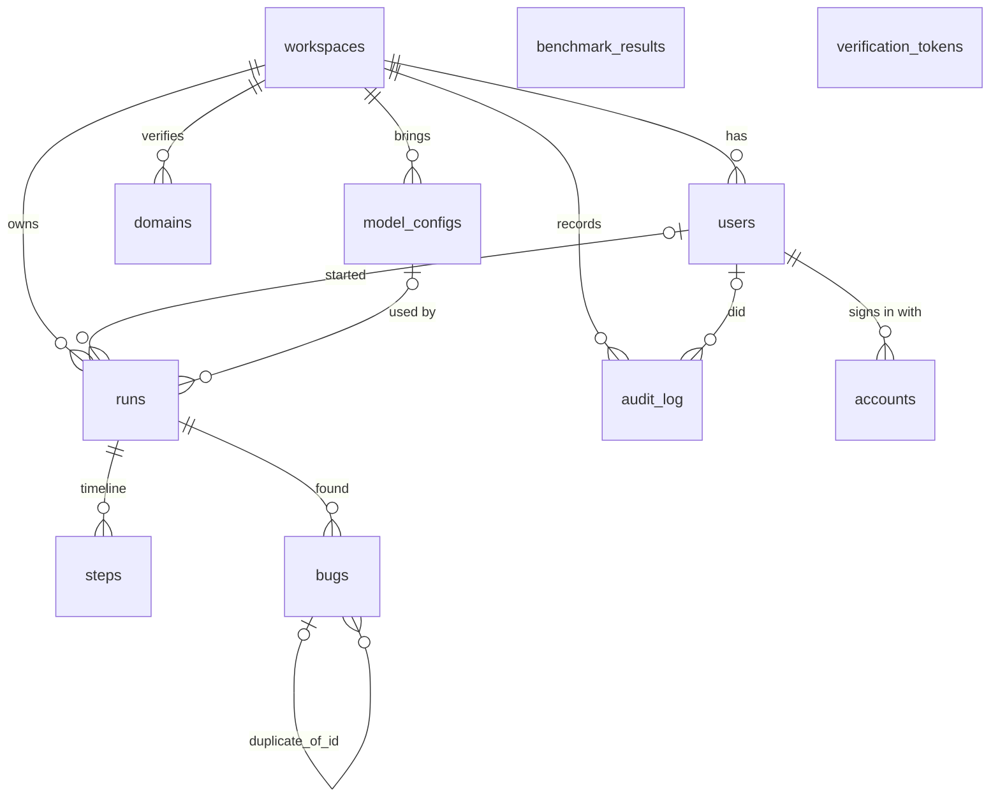

# The database

Postgres is the core of the system. It is the **only** link between the web app (Next.js,
TypeScript, Prisma) and the worker (Python, SQLAlchemy): the web app writes a row, the worker
picks it up, writes its progress back, and the web app reads it. There is no message broker,
no Redis, no API between the two.

```
browser ──HTTP──> web app ──SQL──> Postgres <──SQL── worker ──> Playwright, model
```

Why one database and no broker: one fewer moving part to run, back up and explain; every
state change is a transaction (a run can never be "claimed" in the queue but missing in the
database); and the run page can show live progress just by reading rows. The price is that
the queue is polled (each idle worker asks once per second), which is cheap at this scale (see
"Query plans": a claim takes 0.03 ms).

## Entity diagram



`||--o{` = one to many; `|o--o{` = optional (the column may be null). `benchmark_results` and
`verification_tokens` stand alone.

## Tables

Every id is a UUID made by the database (`gen_random_uuid()`), so ids can't be guessed or
counted, and either app can insert without asking the other for the next number. Every
timestamp is `timestamptz(3)` (UTC, millisecond precision): the web app, the worker and the
database may run in different time zones.

### workspaces — the customer (tenant)
Everything a team owns hangs off its workspace, and every query in the web app filters by
`workspace_id`: that is how one team can't see another's runs.
- `slug` unique (readable id); `monthly_run_quota` (default 50, checked when a run starts);
  `verification_token` unique (put in a DNS TXT record or `/.well-known/ai-test-agent.txt` to
  prove a domain is yours).

### users — people who sign in
- `email` unique (one account per address); `workspace_id` → workspaces (each user belongs
  to one workspace; deleting the workspace deletes its users: `ON DELETE CASCADE`).
- Index `users_workspace_id_idx`: list a workspace's members.

### accounts, verification_tokens — Auth.js's tables
- `accounts`: a GitHub login linked to a user. Unique (`provider`, `provider_account_id`): the
  same GitHub account can't be linked twice.
- `verification_tokens`: one-time email sign-in links. `token` unique.

### runs — one test run, and the job queue
The web app inserts a run as `queued`; a worker claims it, sets `running`, and finally `done`,
`failed` or `stopped`. Columns by purpose:
- *What to test:* `workspace_id`, `created_by_id` (null for visitors; `ON DELETE SET NULL` so
  deleting a user keeps the team's runs), `target_url`, `mode` (passive / interactive),
  `focus`, `model_config_id` (the workspace model to use; null = the worker's default).
- *Queue state:* `status` (enum), `claimed_by` (hostname:pid of the worker), `stop_requested`
  (the Stop button; the worker checks it between steps), `heartbeat_at` (the worker's lease,
  see "The queue"), `created_at` / `started_at` / `finished_at`, `error`.
- *Progress and cost:* `pages_visited`, `step_count`, `input_tokens`, `output_tokens`,
  `cost_usd`, `provider`, `model`. Updated as the run goes, so the live page shows them.
- *Result:* `summary` (JSON written at the end), `share_token` (unique, unguessable; a
  read-only share link; null = not shared).
- Indexes: `runs_status_created_at_idx` (status, created_at) serves the queue (oldest queued
  run) and lease recovery (running runs); `runs_workspace_id_created_at_idx` (workspace_id,
  created_at) serves the runs list and the monthly quota count; `runs_share_token_key` the
  share link lookup.

### steps — a run's timeline
One row per thing the worker did: visit a page, click, type, report a bug, verify a bug.
- `run_id` → runs (`ON DELETE CASCADE`: a run's steps go with it). Unique (`run_id`, `index`):
  one numbering per run, which also serves "the run's steps in order" (that unique constraint
  *is* a B-tree index).
- `action`, `args` (JSON: the element it targeted, its box for the live pane, the result),
  `reasoning` (the model's one-line why), `url`, `screenshot` (a storage key), `events` (JSON:
  console errors and failed requests since the previous step), `blocked` / `block_reason`
  (the safety guard stopped it), tokens and cost of that step.
- There is no separate events table: a run's events live in its steps, so the live page
  needs one query.

### bugs — what a run found
- `run_id` → runs (cascade). Index `bugs_run_id_idx`.
- What: `title`, `severity` (enum), `category`, `page_url`, `expected`, `actual`,
  `repro_steps` (JSON list), `evidence` (JSON: console errors, failed requests, axe results,
  and since run 3 `replay_failure` = why replay couldn't repeat the steps), `screenshot`.
- Where it came from: `source` (deterministic check or agent), `step_indexes` (int array).
- Verification: `status` (candidate → confirmed or dismissed), `dismiss_reason`,
  `duplicate_of_id` (the bug this one duplicates; a plain UUID column, no foreign key, so
  deleting bugs in any order never fails).

### benchmark_results — the measured accuracy of a model
One row per `bench` run: provider, model, the git commit the runs were made on, recall, AI-only
recall, precision, false alarms, cost, duration, the holdout app's numbers, the judge, and
`details` (JSON: per-bug results, every match decision, the run ids, and since run 3 the
verification funnel). Never updated: a rescore adds a new row with `rescore_commit` set.
- Indexes: `benchmark_results_created_at_idx` (newest first: benchmark page, leaderboard, home
  page; added in run 3, see below); `benchmark_results_provider_created_at_idx` (provider,
  created_at) from the first version. No current query filters by provider (the leaderboard
  picks the newest row per model in code), so that one is unused; it costs little to keep
  (a few writes a day).

### audit_log — who did what
`run.started`, `domain.verified`, `share.created`, `share.revoked`, `model.added`, `model.tested`... with `workspace_id`,
`user_id` (null for visitors), `metadata` (JSON; for visitors the IP, which the visitor rate
limit counts). Index (`workspace_id`, `created_at`): "this workspace's events in the last
hour". Never updated or deleted by the app.

### domains — domains a workspace may test interactively
Unique (`workspace_id`, `hostname`): a team adds a host once. `verified_at` null until DNS TXT
or the well-known file proves ownership; `method` says which.

### model_configs — models a workspace brings
`provider` ("openai-compat" or "claude"), `base_url`, `model`, prices per million tokens,
`is_default`, `probe` (the last Test connection result). The API key is stored only as
`api_key_ciphertext`: AES-256-GCM with a server key (`MODEL_KEYS_SECRET`) and the workspace id
as associated data, so a ciphertext copied into another workspace's row fails to decrypt.
`api_key_last4` is what the page shows. Index on `workspace_id`.
- Not enforced by the database: "at most one default per workspace" (the API clears the old
  default in the same transaction). A partial unique index
  (`UNIQUE (workspace_id) WHERE is_default`) would make it a database rule; noted, not done.

## Keys and constraints, in one place
- **Primary keys:** `id uuid` everywhere (except `verification_tokens`, keyed by its unique
  token).
- **Foreign keys:** every child points at its parent. `ON DELETE CASCADE` where the child has
  no meaning alone (a workspace's runs, users, domains, models; a run's steps and bugs; a
  user's accounts). `ON DELETE SET NULL` where history should survive (a run or audit entry
  keeps existing when its user or model config is deleted).
- **Unique:** emails, workspace slugs and verification tokens, share tokens, (run, step
  index), (workspace, hostname), (provider, provider account).
- **Enums** for closed sets the code switches on (`run_status`, `run_mode`, `severity`,
  `bug_source`, `bug_status`): the database refuses a typo like `"runing"`.
- **NOT NULL with defaults** for counters and JSON (`0`, `'{}'`, `'[]'`), so neither app has
  to handle null there.

## The queue

### Claiming: `SELECT ... FOR UPDATE SKIP LOCKED`
```sql
SELECT * FROM runs WHERE status = 'queued' ORDER BY created_at LIMIT 1
FOR UPDATE SKIP LOCKED;
-- then, in the same transaction:
UPDATE runs SET status = 'running', claimed_by = 'host:pid', started_at = now(),
                heartbeat_at = now() WHERE id = ...;
COMMIT;
```
- `FOR UPDATE` locks the chosen row until the transaction ends.
- `SKIP LOCKED` makes another worker running the same query at the same moment *skip* that
  locked row and take the next one, instead of waiting for the lock (which would serialise
  the workers) or taking the same row (which plain `SELECT` would do).
- The status change commits immediately, so the row stops matching `status = 'queued'` and
  the lock is released after a few milliseconds; the long run itself holds no lock.
- Isolation level: Postgres's default, READ COMMITTED. That's enough here because the lock,
  not the snapshot, decides who gets the row.
- **Proof** (`apps/worker/tests/test_queue_concurrency.py`): 8 worker threads, each with its
  own connection, start at the same instant against 300 queued runs; every run is claimed
  exactly once, none is lost, the work is shared, and each run records the worker that has it.

### Crashed workers: a lease (`heartbeat_at`)
A worker can die mid-run (crash, deploy, laptop closed). Before run 3 its run stayed
`running` until *some* worker restarted and checked `started_at` against the longest a run may
take (~13 minutes). Now:
- Claiming sets `heartbeat_at = now()`. While the run is processed, a background thread
  (`Heartbeat`, its own connection) sets `heartbeat_at = now()` every 15 s, only while the run
  is still `running`.
- Every live worker, every 30 s, fails runs whose lease (60 s) has expired, in **one**
  statement: `UPDATE runs SET status = 'failed', error = 'the worker stopped responding (no
  heartbeat for 60 s)' WHERE status = 'running' AND coalesce(heartbeat_at, started_at) <
  now() - interval '60 seconds'`. Two workers doing this at once is safe: the second UPDATE
  waits for the first's row lock, then re-checks its WHERE and finds the row no longer running.
- All lease times come from the **database clock** (`now()`), never a worker's clock, so two
  machines with skewed clocks still agree on what "60 s ago" means.
- A worker that was only frozen (not dead) and wakes up must not undo the recovery: before
  writing the final status it re-reads the row with `SELECT ... FOR UPDATE` and leaves it alone
  if it isn't `running` any more. The lock makes recovery wait until that final write commits.
- Failed, not re-queued: an interactive run may already have clicked things on the customer's
  site; running it again silently could repeat side effects.
- The old start-time check stays as an upper bound (a worker whose heartbeat thread lives but
  whose main thread hangs).
- Tests: lease starts at claim; expired lease → failed by another worker; a long run with a
  fresh heartbeat is left alone; the heartbeat renews; a late worker can't turn `failed` back
  into `done`.

### Other locking in the app
Starting a run (web, `lib/runs.ts`) runs in a transaction that first locks the workspace row
(`SELECT monthly_run_quota FROM workspaces WHERE id = $1 FOR UPDATE`), then counts this
month's runs (and the visitor's runs in the last hour) and inserts the run. Two "Start" clicks
at once can't both pass the quota check: the second waits for the first's lock and then counts
the first's run.

## Query plans (run 3)

`apps/worker/scripts/db_perf.py` builds a throwaway `agent_perf` database from the real
migrations, seeds **10,000 runs** (40% in one big workspace), **500,000 steps**, 50,000 bugs,
10,000 audit rows and 2,000 benchmark results, and runs `EXPLAIN (ANALYZE, BUFFERS)` on each hot
query 7 times (median shown). Laptop, Postgres 17 in Docker, with the local model busy in the
background, so absolute numbers are noisy; the plan shapes are what matter.

| Query (who runs it, how often) | Before | After | Plan after |
|---|---|---|---|
| Claim the next run (worker, every second per idle worker) | 0.029 ms | 0.028 ms | Index Scan on `runs_status_created_at_idx` |
| Run page: the run (web, every 1.5 s while open) | 0.012 ms | 0.014 ms | Index Scan on `runs_pkey` |
| Run page / live pane: its 50 steps | 0.075 ms | 0.099 ms | Bitmap scan on `steps_run_id_index_key` |
| Run page: its bugs | 0.020 ms | 0.026 ms | Bitmap scan on `bugs_run_id_idx` |
| Runs list of a workspace (newest 50 of 4,000) | 0.030 ms | 0.036 ms | Index Scan Backward on `runs_workspace_id_created_at_idx` |
| Quota: this month's runs (start a run) | 0.509 ms | 0.593 ms | Bitmap scan on the same index (Index Only Scan after VACUUM) |
| Visitor limit: this IP's runs in the last hour | 0.021 ms | 0.023 ms | Bitmap scan on `audit_log_workspace_id_created_at_idx` |
| Lease recovery: expired running runs | 0.011 ms | 0.012 ms | Index Scan on `runs_status_created_at_idx` |
| **Leaderboard / benchmark page (newest 200)** | **0.872 ms** | **0.091 ms** | Seq Scan + sort → Index Scan Backward on `benchmark_results_created_at_idx` |
| **Home page: newest benchmark result** | **0.964 ms** | **0.011 ms** | Seq Scan + sort → Index Scan Backward on the same |

What the plans showed:
- **One index added**, `benchmark_results(created_at)`: before, Postgres read all 2,000 rows
  and sorted them to return the newest 200 (or 1); the cost grows with every benchmark ever
  run. After, it walks the index from the newest end and stops after 200 (or 1) entries.
- **Everything else was already served by an index** that the first schema created for that
  query. No other index would help, so none was added (each index slows every insert a little
  and takes space).
- **Quota count:** it reads 1,905 index entries plus 97 table pages to check visibility. After
  `VACUUM` (which autovacuum does on its own in production) it becomes an Index Only Scan with
  0 heap fetches and 21 buffers instead of 116. It's a count over this month's runs, so it
  grows with a workspace's monthly volume, not with history.
- **Known cost, not an index problem:** the live run page reloads *all* of a run's steps every
  1.5 s, including their JSON. 50 steps take 0.1 ms in the database, but the rows are a few
  KB each over the wire. If runs grow to hundreds of steps, fetch only steps with an index
  above the last one seen (the unique (run_id, index) index already supports that).

Rerun: `cd apps/worker && uv run python scripts/db_perf.py --plans`.

## Prisma and SQLAlchemy: one schema, two apps

- **Prisma owns the schema.** `apps/web/prisma/schema.prisma` is the source of truth; every
  change is a migration in `apps/web/prisma/migrations/<timestamp>_<name>/migration.sql`,
  applied with `npm run db:migrate` (`prisma migrate deploy`). Migrations are only ever added,
  never edited after they ran, so every database can be rebuilt by replaying them in order.
- **SQLAlchemy mirrors it.** `apps/worker/src/worker/db/models.py` declares the same tables and
  columns (and uses the existing enum types with `create_type=False`). The worker never creates
  or alters tables.
- **The drift test** (`apps/worker/tests/test_db_models.py`) builds a fresh `agent_test`
  database by running Prisma's migration SQL files in order (no Node needed), then checks that
  every SQLAlchemy table exists with exactly the same columns and the same nullability, and
  that every index a hot query needs exists (`HOT_QUERY_INDEXES`, with the query each serves).
  If someone adds a column in Prisma and forgets the mirror, or drops an index, CI fails.
- **Making a schema change:** edit `schema.prisma` → `npx prisma migrate dev --name <what>`
  (writes the SQL; or write the SQL by hand, as run 3 did) → mirror columns in `models.py` →
  `npm test` (drift test) → commit both.

## Migrations so far
| Migration | What |
|---|---|
| `20261109020336_init` | workspaces, users, runs, steps, bugs, benchmark results, audit log |
| `20261109050000_auth_domains_sharing` | Auth.js tables, domains, share tokens |
| `20261110120000_honest_benchmark` | AI-only recall, holdout columns, judge, rescore commit |
| `20261110130000_model_configs` | workspace models, `runs.model_config_id` |
| `20261111010000_run_lease` | `runs.heartbeat_at` (run 3, the lease) |
| `20261111020000_benchmark_results_newest` | `benchmark_results(created_at)` index (run 3) |

## Interview questions
1. **Why `SKIP LOCKED` and not just `FOR UPDATE`?** With plain `FOR UPDATE`, a second worker
   picking the same oldest row waits until the first commits, then re-checks and finds it
   taken: workers queue up behind each other. `SKIP LOCKED` makes it take the next free row
   immediately. Without any lock, two workers can read the same "queued" row and both run it.
2. **What happens if a worker dies mid-run?** Its heartbeat stops. Within ~90 s (60 s lease +
   up to 30 s until a worker checks), any live worker fails the run with "no heartbeat" in one
   conditional UPDATE. If the worker was only frozen and comes back, it re-reads the row under
   a lock and leaves the failed status alone.
3. **How do you know an index helps?** `EXPLAIN (ANALYZE, BUFFERS)` on realistic volume, before
   and after: here the benchmark page went from a Seq Scan + sort over every row (0.87 ms,
   growing) to an index scan that stops after 200 rows (0.09 ms). Every other hot query already
   used an index, so nothing else was added.
