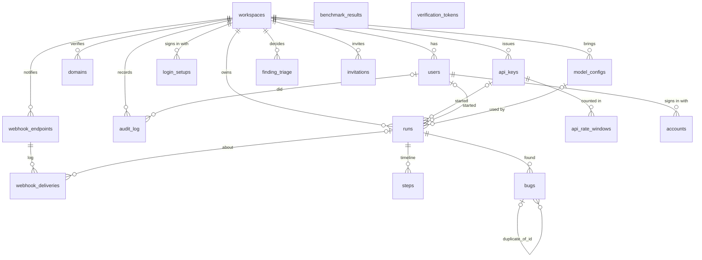

# The database

Postgres is the core of the system. It is the **only** link between the web app (Next.js,
TypeScript, Prisma) and the worker (Python, SQLAlchemy): the web app writes a row, the worker
picks it up, writes its progress back, and the web app reads it. There is no message broker,
no Redis, no API between the two.

```
browser ──HTTP──> web app ──SQL──> Postgres <──SQL── worker ──> Playwright, model
```

Why one database and no broker: one fewer moving part to run, back up and explain; every
state change is a transaction (a run can never be "claimed" in the queue but missing in the
database); and the run page can show live progress just by reading rows. The price is that
the queue is polled (each idle worker asks once per second), which is cheap at this scale (see
"Query plans": a claim takes 0.03 ms).

## Entity diagram



`||--o{` = one to many; `|o--o{` = optional (the column may be null). `benchmark_results` and
`verification_tokens` stand alone.

## Tables

Every id is a UUID made by the database (`gen_random_uuid()`), so ids can't be guessed or
counted, and either app can insert without asking the other for the next number. Every
timestamp is `timestamptz(3)` (UTC, millisecond precision): the web app, the worker and the
database may run in different time zones.

### workspaces — the customer (tenant)
Everything a team owns hangs off its workspace, and every query in the web app filters by
`workspace_id`: that is how one team can't see another's runs.
- `slug` unique (readable id); `monthly_run_quota` (default 50, checked when a run starts);
  `verification_token` unique (put in a DNS TXT record or `/.well-known/ai-test-agent.txt` to
  prove a domain is yours).

### users — people who sign in
- `email` unique (one account per address); `workspace_id` → workspaces (each user belongs
  to one workspace; deleting the workspace deletes its users: `ON DELETE CASCADE`).
- Index `users_workspace_id_idx`: list a workspace's members.

### accounts, verification_tokens — Auth.js's tables
- `accounts`: a GitHub login linked to a user. Unique (`provider`, `provider_account_id`): the
  same GitHub account can't be linked twice.
- `verification_tokens`: one-time email sign-in links. `token` unique.

### runs — one test run, and the job queue
The web app inserts a run as `queued`; a worker claims it, sets `running`, and finally `done`,
`failed` or `stopped`. Columns by purpose:
- *What to test:* `workspace_id`, `created_by_id` (null for visitors; `ON DELETE SET NULL` so
  deleting a user keeps the team's runs), `target_url`, `mode` (passive / interactive),
  `focus`, `model_config_id` (the workspace model to use; null = the worker's default).
- *Queue state:* `status` (enum), `claimed_by` (hostname:pid of the worker), `stop_requested`
  (the Stop button; the worker checks it between steps), `heartbeat_at` (the worker's lease,
  see "The queue"), `created_at` / `started_at` / `finished_at`, `error`.
- *Progress and cost:* `pages_visited`, `step_count`, `input_tokens`, `output_tokens`,
  `cost_usd`, `provider`, `model`. Updated as the run goes, so the live page shows them.
- *Result:* `summary` (JSON written at the end), `share_token` (unique, unguessable; a
  read-only share link; null = not shared).
- Indexes: `runs_status_created_at_idx` (status, created_at) serves the queue (oldest queued
  run) and lease recovery (running runs); `runs_workspace_id_created_at_idx` (workspace_id,
  created_at) serves the runs list and the monthly quota count; `runs_share_token_key` the
  share link lookup.

### steps — a run's timeline
One row per thing the worker did: visit a page, click, type, report a bug, verify a bug.
- `run_id` → runs (`ON DELETE CASCADE`: a run's steps go with it). Unique (`run_id`, `index`):
  one numbering per run, which also serves "the run's steps in order" (that unique constraint
  *is* a B-tree index).
- `action`, `args` (JSON: the element it targeted, its box for the live pane, the result),
  `reasoning` (the model's one-line why), `url`, `screenshot` (a storage key), `events` (JSON:
  console errors and failed requests since the previous step), `blocked` / `block_reason`
  (the safety guard stopped it), tokens and cost of that step.
- There is no separate events table: a run's events live in its steps, so the live page
  needs one query.

### bugs — what a run found
- `run_id` → runs (cascade). Index `bugs_run_id_idx`.
- What: `title`, `severity` (enum), `category`, `page_url`, `expected`, `actual`,
  `repro_steps` (JSON list), `evidence` (JSON: console errors, failed requests, axe results,
  and since run 3 `replay_failure` = why replay couldn't repeat the steps), `screenshot`.
- Where it came from: `source` (deterministic check or agent), `step_indexes` (int array).
- Verification: `status` (candidate → confirmed or dismissed), `dismiss_reason`,
  `duplicate_of_id` (the bug this one duplicates; a plain UUID column, no foreign key, so
  deleting bugs in any order never fails).

### benchmark_results — the measured accuracy of a model
One row per `bench` run: provider, model, the git commit the runs were made on, recall, AI-only
recall, precision, false alarms, cost, duration, the holdout app's numbers, the judge, and
`details` (JSON: per-bug results, every match decision, the run ids, and since run 3 the
verification funnel). Never updated: a rescore adds a new row with `rescore_commit` set.
- Indexes: `benchmark_results_created_at_idx` (newest first: benchmark page, leaderboard, home
  page; added in run 3, see below); `benchmark_results_provider_created_at_idx` (provider,
  created_at) from the first version. No current query filters by provider (the leaderboard
  picks the newest row per model in code), so that one is unused; it costs little to keep
  (a few writes a day).

### audit_log — who did what
`run.started`, `domain.verified`, `share.created`, `share.revoked`, `model.added`, `model.tested`... with `workspace_id`,
`user_id` (null for visitors), `metadata` (JSON; for visitors the IP, which the visitor rate
limit counts). Index (`workspace_id`, `created_at`): "this workspace's events in the last
hour". Never updated or deleted by the app.

### domains — domains a workspace may test interactively
Unique (`workspace_id`, `hostname`): a team adds a host once. `verified_at` null until DNS TXT
or the well-known file proves ownership; `method` says which.

### model_configs — models a workspace brings
`provider` ("openai-compat" or "claude"), `base_url`, `model`, prices per million tokens,
`is_default`, `probe` (the last Test connection result). The API key is stored only as
`api_key_ciphertext`: AES-256-GCM with a server key (`MODEL_KEYS_SECRET`) and the workspace id
as associated data, so a ciphertext copied into another workspace's row fails to decrypt.
`api_key_last4` is what the page shows. Index on `workspace_id`.
- Not enforced by the database: "at most one default per workspace" (the API clears the old
  default in the same transaction). A partial unique index
  (`UNIQUE (workspace_id) WHERE is_default`) would make it a database rule; noted, not done.

### login_setups — how the worker signs in to an app (run 4)
One row per workspace and target origin (`UNIQUE (workspace_id, origin)`): a login form (`kind =
'form'`: `login_url`, `username`, `password_ciphertext`, optional selectors) or a recorded sign-in
(`kind = 'storage_state'`: `storage_state_ciphertext`). The password and the storage state are
AES-256-GCM encrypted like model keys (workspace id as associated data, so a ciphertext copied into
another workspace's row doesn't decrypt). The username is plain: settings show it so people know
which test account it is; it is still scrubbed from everything the model or a report sees.
`check_requested_at` is a tiny job queue for "Test sign-in": the web sets it, a worker claims the
row `FOR UPDATE SKIP LOCKED`, signs in, writes `last_check` (`{ok, detail, checkedAt}`, never a
secret) and clears it. No index on it: a workspace has a handful of setups.

### api_keys — keys for the public API (run 4)
Only `key_hash` (SHA-256, `UNIQUE`) is stored, never the key. A password needs a slow hash
because people choose guessable ones; a key is 32 random bytes, so nothing can brute-force it
and a fast hash plus a unique index makes every request one equality lookup. `prefix` (first 12
characters) lets people tell keys apart; `revoked_at` ends a key at once while keeping the row for
the audit trail; `last_used_at` is written at most once a minute. Index `(workspace_id,
created_at)` for the settings list. `runs.api_key_id` (`ON DELETE SET NULL`) records which key
started a run.

### api_rate_windows — requests per key per minute (run 4)
Primary key `(api_key_id, window_start)`. Each request runs one statement:
`INSERT ... VALUES (key, minute, 1) ON CONFLICT (api_key_id, window_start) DO UPDATE SET count =
count + 1 RETURNING count`. The row lock taken by the upsert serialises parallel requests, so 8
simultaneous requests against a limit of 5 let exactly 5 through (tested), and it works across
several web servers, unlike a counter in memory. Old windows are removed by the retention job.

### webhook_endpoints, webhook_deliveries — signed run notifications (run 4)
An endpoint is a URL and an encrypted signing secret (the worker must read it to sign, so it can't
be hashed). A delivery is one event for one endpoint: `status` (`pending` → `delivered` or
`failed`), `attempts`, `next_attempt_at`, `last_status_code`, `last_error`. The worker claims due
deliveries with `WHERE status = 'pending' AND next_attempt_at <= now() ... FOR UPDATE SKIP LOCKED`,
served by the index `(status, next_attempt_at)`; `(endpoint_id, created_at)` serves "the last 10
deliveries" in settings. `run_id` is `ON DELETE SET NULL`: the log outlives a deleted run.

### bugs: fingerprint and suppressed; finding_triage (run 4, J4)
`bugs.fingerprint` (16 hex characters) recognises the same bug in later runs of a target:
SHA-256 over the page route with ids normalised, the category and a key (failing request,
message without numbers, axe rule, link, or the element an agent report was about). Set for
every insert by a SQLAlchemy `before_insert` hook, so no code path can forget it; older rows were
filled by `uv run worker backfill-fingerprints`. `bugs.suppressed`: hidden because the workspace
triaged that fingerprint as a false positive; set by the worker when a run finishes.

`finding_triage` holds the current decision per `(workspace_id, origin, fingerprint)` (`UNIQUE`,
which also serves the lookup "decisions for these fingerprints on this site"). `state` is limited
by a CHECK constraint to `confirmed`, `false_positive`, `wont_fix` (Prisma can't express CHECKs;
the migration adds it). History (who changed what, when) is in `audit_log` (`triage.changed`).
Comparing with the previous run reads that run's bugs by `run_id` (indexed); no index on
`bugs.fingerprint` is needed because fingerprints are only compared within two runs.

### Retention (run 4, J6)
`workspaces.retention_days` (default 30) and `runs.purged_at`. Once an hour a worker finds finished
runs older than their workspace's retention (`finished_at < now() - make_interval(days =>
retention_days)`, a join on workspaces), deletes their screenshots from storage and their steps,
clears the findings' screenshot references and sets `purged_at`, one run per transaction. Runs and
findings stay: release comparison needs their fingerprints. Rate-limit windows older than an hour
are deleted in the same pass.

### runs: budgets from the API (run 4)
`max_steps` and `max_seconds` (nullable): a CI caller may lower the worker's limits for one run,
never raise them (`run_limits()` takes the smaller value).

## Keys and constraints, in one place
- **Primary keys:** `id uuid` everywhere (except `verification_tokens`, keyed by its unique
  token).
- **Foreign keys:** every child points at its parent. `ON DELETE CASCADE` where the child has
  no meaning alone (a workspace's runs, users, domains, models; a run's steps and bugs; a
  user's accounts). `ON DELETE SET NULL` where history should survive (a run or audit entry
  keeps existing when its user or model config is deleted).
- **Unique:** emails, workspace slugs and verification tokens, share tokens, (run, step
  index), (workspace, hostname), (provider, provider account).
- **Enums** for closed sets the code switches on (`run_status`, `run_mode`, `severity`,
  `bug_source`, `bug_status`): the database refuses a typo like `"runing"`.
- **NOT NULL with defaults** for counters and JSON (`0`, `'{}'`, `'[]'`), so neither app has
  to handle null there.

## The queue

### Claiming: `SELECT ... FOR UPDATE SKIP LOCKED`
```sql
SELECT * FROM runs WHERE status = 'queued' ORDER BY created_at LIMIT 1
FOR UPDATE SKIP LOCKED;
-- then, in the same transaction:
UPDATE runs SET status = 'running', claimed_by = 'host:pid', started_at = now(),
                heartbeat_at = now() WHERE id = ...;
COMMIT;
```
- `FOR UPDATE` locks the chosen row until the transaction ends.
- `SKIP LOCKED` makes another worker running the same query at the same moment *skip* that
  locked row and take the next one, instead of waiting for the lock (which would serialise
  the workers) or taking the same row (which plain `SELECT` would do).
- The status change commits immediately, so the row stops matching `status = 'queued'` and
  the lock is released after a few milliseconds; the long run itself holds no lock.
- Isolation level: Postgres's default, READ COMMITTED. That's enough here because the lock,
  not the snapshot, decides who gets the row.
- **Proof** (`apps/worker/tests/test_queue_concurrency.py`): 8 worker threads, each with its
  own connection, start at the same instant against 300 queued runs; every run is claimed
  exactly once, none is lost, the work is shared, and each run records the worker that has it.

### Crashed workers: a lease (`heartbeat_at`)
A worker can die mid-run (crash, deploy, laptop closed). Before run 3 its run stayed
`running` until *some* worker restarted and checked `started_at` against the longest a run may
take (~13 minutes). Now:
- Claiming sets `heartbeat_at = now()`. While the run is processed, a background thread
  (`Heartbeat`, its own connection) sets `heartbeat_at = now()` every 15 s, only while the run
  is still `running`.
- Every live worker, every 30 s, fails runs whose lease (60 s) has expired, in **one**
  statement: `UPDATE runs SET status = 'failed', error = 'the worker stopped responding (no
  heartbeat for 60 s)' WHERE status = 'running' AND coalesce(heartbeat_at, started_at) <
  now() - interval '60 seconds'`. Two workers doing this at once is safe: the second UPDATE
  waits for the first's row lock, then re-checks its WHERE and finds the row no longer running.
- All lease times come from the **database clock** (`now()`), never a worker's clock, so two
  machines with skewed clocks still agree on what "60 s ago" means.
- A worker that was only frozen (not dead) and wakes up must not undo the recovery: before
  writing the final status it re-reads the row with `SELECT ... FOR UPDATE` and leaves it alone
  if it isn't `running` any more. The lock makes recovery wait until that final write commits.
- Failed, not re-queued: an interactive run may already have clicked things on the customer's
  site; running it again silently could repeat side effects.
- The old start-time check stays as an upper bound (a worker whose heartbeat thread lives but
  whose main thread hangs).
- Tests: lease starts at claim; expired lease → failed by another worker; a long run with a
  fresh heartbeat is left alone; the heartbeat renews; a late worker can't turn `failed` back
  into `done`.

### Other locking in the app
Starting a run (web, `lib/runs.ts`) runs in a transaction that first locks the workspace row
(`SELECT monthly_run_quota FROM workspaces WHERE id = $1 FOR UPDATE`), then counts this
month's runs (and the visitor's runs in the last hour) and inserts the run. Two "Start" clicks
at once can't both pass the quota check: the second waits for the first's lock and then counts
the first's run.

## Query plans (run 3)

`apps/worker/scripts/db_perf.py` builds a throwaway `agent_perf` database from the real
migrations, seeds **10,000 runs** (40% in one big workspace), **500,000 steps**, 50,000 bugs,
10,000 audit rows and 2,000 benchmark results, and runs `EXPLAIN (ANALYZE, BUFFERS)` on each hot
query 7 times (median shown). Laptop, Postgres 17 in Docker, with the local model busy in the
background, so absolute numbers are noisy; the plan shapes are what matter.

| Query (who runs it, how often) | Before | After | Plan after |
|---|---|---|---|
| Claim the next run (worker, every second per idle worker) | 0.029 ms | 0.028 ms | Index Scan on `runs_status_created_at_idx` |
| Run page: the run (web, every 1.5 s while open) | 0.012 ms | 0.014 ms | Index Scan on `runs_pkey` |
| Run page / live pane: its 50 steps | 0.075 ms | 0.099 ms | Bitmap scan on `steps_run_id_index_key` |
| Run page: its bugs | 0.020 ms | 0.026 ms | Bitmap scan on `bugs_run_id_idx` |
| Runs list of a workspace (newest 50 of 4,000) | 0.030 ms | 0.036 ms | Index Scan Backward on `runs_workspace_id_created_at_idx` |
| Quota: this month's runs (start a run) | 0.509 ms | 0.593 ms | Bitmap scan on the same index (Index Only Scan after VACUUM) |
| Visitor limit: this IP's runs in the last hour | 0.021 ms | 0.023 ms | Bitmap scan on `audit_log_workspace_id_created_at_idx` |
| Lease recovery: expired running runs | 0.011 ms | 0.012 ms | Index Scan on `runs_status_created_at_idx` |
| **Leaderboard / benchmark page (newest 200)** | **0.872 ms** | **0.091 ms** | Seq Scan + sort → Index Scan Backward on `benchmark_results_created_at_idx` |
| **Home page: newest benchmark result** | **0.964 ms** | **0.011 ms** | Seq Scan + sort → Index Scan Backward on the same |

What the plans showed:
- **One index added**, `benchmark_results(created_at)`: before, Postgres read all 2,000 rows
  and sorted them to return the newest 200 (or 1); the cost grows with every benchmark ever
  run. After, it walks the index from the newest end and stops after 200 (or 1) entries.
- **Everything else was already served by an index** that the first schema created for that
  query. No other index would help, so none was added (each index slows every insert a little
  and takes space).
- **Quota count:** it reads 1,905 index entries plus 97 table pages to check visibility. After
  `VACUUM` (which autovacuum does on its own in production) it becomes an Index Only Scan with
  0 heap fetches and 21 buffers instead of 116. It's a count over this month's runs, so it
  grows with a workspace's monthly volume, not with history.
- **Known cost, not an index problem:** the live run page reloads *all* of a run's steps every
  1.5 s, including their JSON. 50 steps take 0.1 ms in the database, but the rows are a few
  KB each over the wire. If runs grow to hundreds of steps, fetch only steps with an index
  above the last one seen (the unique (run_id, index) index already supports that).

Rerun: `cd apps/worker && uv run python scripts/db_perf.py --plans`.

## Roles and invitations (run 4, J5)
`users.role` (enum `workspace_role`: owner, admin, member, viewer). Whoever signs up owns the
workspace created for them; existing users became owners in the migration. `invitations` store a
SHA-256 hash of the link's token, the role (a CHECK forbids `owner`: ownership is transferred,
not handed out), `expires_at`, and `accepted_at` / `revoked_at`. Accepting is one transaction
whose `UPDATE ... WHERE accepted_at IS NULL` makes a link work once even if two people open it
together. What each role may do is one table in `apps/web/lib/roles.ts`; every route uses it and
`route-roles.db.test.ts` calls every protected route as every role.

"One default model per workspace" is a database rule: a partial unique index
`UNIQUE (workspace_id) WHERE is_default` (Prisma's `partialIndexes` preview feature), so code that
forgets to unset the old default gets an error instead of two defaults.

## Row-level security (run 4, J5)
The app filters every query by `workspace_id`. Row-level security (RLS) is a second wall inside
Postgres: if a query forgets its WHERE, the database still returns only the current workspace.

- **Policies:** each tenant table has `ENABLE ROW LEVEL SECURITY` and a policy `tenant_isolation`
  for the role `app_tenant`: `USING (workspace_id = app_current_workspace())` (and `WITH CHECK`,
  so rows can't be written into another workspace). Tables without a `workspace_id` (steps, bugs,
  webhook_deliveries, api_rate_windows) check through their parent: `EXISTS (SELECT 1 FROM runs r
  WHERE r.id = steps.run_id)`; the parent is itself filtered, so the child inherits it.
- **The current workspace** is a per-transaction setting: `set_config('app.workspace_id', id,
  true)`. `app_current_workspace()` turns an unset value into NULL, which matches no row: a
  transaction that forgot to set it sees nothing (fails closed).
- **Prisma:** `tenantDb(workspaceId)` (`apps/web/lib/tenant-db.ts`) is a client extension that
  runs every query in a batch transaction: `set_config(...)`, `SET LOCAL ROLE app_tenant`, the
  query. `LOCAL` means both end with the transaction, so a pooled connection never carries one
  tenant's setting into the next request. The run page, run list, API reads and the settings
  lists use it; the WHERE clauses stay (first line of defence).
- **The worker (since run 5):** connects as `ata_worker` and works on a run inside that run's
  workspace (`worker/db/tenant.py`); see "Rules in the database" below. (Run 4 had the worker
  connect as the owner, outside the policies.)
- **Production (since run 5):** the app roles `ata_web` and `ata_worker` are neither superusers
  nor `BYPASSRLS`; only migrations and the role script use the admin connection.
- **Tests:** `rls.db.test.ts`: a query without WHERE sees only its workspace (runs, bugs, steps,
  workspaces); writing into another workspace fails; updating its rows changes nothing; an unset
  workspace sees nothing; the owner role sees everything.

**Cost** (EXPLAIN ANALYZE on 10k runs / 500k steps, `scripts/db_perf.py --rls`, median of 7):

| Query | Owner | app_tenant (RLS) | Plan with RLS |
|---|---|---|---|
| run page: the run | 0.006 ms | 0.010 ms | Index Scan using runs_pkey |
| run page: its steps (50) | 0.038 ms | 0.066 ms | Index Scan using steps_run_id_index_key |
| run page: its bugs | 0.013 ms | 0.021 ms | Bitmap Heap Scan on bugs |
| runs list (newest 50) | 0.018 ms | 0.029 ms | Index Scan Backward using runs_workspace_id_created_at_idx |

The policies add tens of microseconds because the parent check is a primary-key lookup and the
plans keep their indexes. The larger cost is two extra statements per query (`set_config`, `SET
LOCAL ROLE`) in the same round trip batch: about 0.1–0.3 ms locally, per query.

## Rules in the database (run 5, K3)

Run 4 kept most rules in app code: the web app wrote the audit log, the worker claimed runs
with its own SQL, two places counted the monthly quota. A rule in app code holds only for that
app; the database is the one place every writer passes through (the web app, the worker, a
migration, an operator with psql). Run 5 moves the rules that must never be skipped into
Postgres, each tested by calling the database directly (`apps/worker/tests/test_db_rules.py`,
`apps/web/lib/rls.db.test.ts`).

**Tables: 18** (plus Prisma's `_prisma_migrations`; K4 adds plans and usage events). No table
was added for K3: the rules are functions, triggers, views and constraints on the tables that
exist.

### Roles
| Role | Login | Used by | Can |
|---|---|---|---|
| `ata_owner` | yes | migrations (on a managed database) | owns every table, view, sequence, type and function; the only role (besides a superuser) that can change the schema or switch row-level security off |
| `ata_web` | yes | the web app (`WEB_DATABASE_URL`) | tenant rows only inside a tenant transaction; read `users` for sign-in; `accounts`/`verification_tokens`; the web functions below |
| `ata_worker` | yes | the worker (`WORKER_DATABASE_URL`) | tenant rows only inside a run's workspace; the worker functions below; write `benchmark_results` |
| `app_tenant` | no | `SET LOCAL ROLE` inside a tenant transaction | the tenant policies apply to it (and to its members, `ata_web` and `ata_worker`) |

None is a superuser, none has `BYPASSRLS` or `CREATEROLE` (tested). The admin connection
(`DATABASE_URL`) is used only by migrations, `npm run db:roles` (`apps/web/scripts/db-roles.mjs`,
which creates missing roles and sets passwords from `DB_*_PASSWORD`), the test setup, and the
worker's maintenance commands run by an operator (`bench`, `reverify`, `backfill-fingerprints`).
The web app and the workers never get it (production compose gives each container only its own
URL).

### Functions
| Function | Kind | Who may call | What and why in the database |
|---|---|---|---|
| `claim_next_run(worker, only, skip_benchmark)` | SECURITY DEFINER | ata_worker | `FOR UPDATE SKIP LOCKED` on the oldest queued run, status, claim and lease in one statement. The one place that looks across workspaces for the queue; returns only id and workspace. |
| `renew_lease(run)` | SECURITY DEFINER | ata_worker | heartbeat; only while the run is still running |
| `recover_runs(lease_s)` | SECURITY DEFINER | ata_worker | fails runs whose lease expired, in one UPDATE (two workers can't both fail a run) |
| `consume_quota(workspace)` | INVOKER | app_tenant | locks the workspace row for the rest of the transaction, counts this month's runs, returns allowed/used/quota. The caller inserts its run in the same transaction: a burst of starts can't overshoot. Under RLS a tenant can only consume its own quota. |
| `apply_retention(now, batch)` | SECURITY DEFINER | ata_worker | purges expired runs (steps deleted, screenshots unlinked, `purged_at`), old rate windows; returns run ids so the worker deletes their files |
| `due_webhook_deliveries(limit)`, `requested_login_checks(limit)` | SECURITY DEFINER | ata_worker | what is due anywhere (ids and workspaces only); each item is then locked and processed inside its workspace |
| `api_key_by_hash`, `shared_run`, `invitation_by_token`, `accept_invitation`, `demo_workspace`, `service_metrics` | SECURITY DEFINER | ata_web | the justified bypasses, below |
| `remove_member(user)` | SECURITY DEFINER | app_tenant | moves a member out of the current workspace into a new one of their own (acts only in `app.workspace_id`) |
| `url_origin(url)`, `app_current_workspace()`, `app_current_user()` | helpers | app_tenant | the origin rule of the worker's `origin_of`; the transaction's workspace and user |

Every SECURITY DEFINER function sets `search_path = public, pg_temp` (so a caller can't plant a
look-alike table) and has `EXECUTE` revoked from PUBLIC and granted to one role.

### Triggers
| Trigger | On | Does |
|---|---|---|
| `*_updated_at` | `login_setups`, `model_configs`, `finding_triage` | `updated_at = now()` on every update, whoever updates |
| `bugs_carry_triage` | `bugs` insert / fingerprint change | a finding whose fingerprint the workspace marked a false positive on that target is stored `suppressed`, in every later run (replaces the worker's `apply_triage`) |
| `*_audit` (`audit_change`) | runs, domains, model_configs, login_setups, api_keys, webhook_endpoints, invitations, users, finding_triage, workspaces | writes the audit log with the actor from `app.user_id` and context from `app.audit_metadata` (the visitor's IP, the API key); only names and ids of what changed, never a secret column's value. The action names are the ones the app used (`run.started`, `model.added`, `api_key.revoked`, `member.role_changed`, …). The app no longer writes audit rows. |
| `benchmark_results_refresh_leaderboard` | `benchmark_results`, statement level | refreshes `model_leaderboard` |

`audit_log` is append-only for the app roles (`UPDATE`, `DELETE` revoked): what happened can't be
edited or erased by the apps.

### Views
- **`target_bug_history`** (`security_invoker`): per workspace, target origin and fingerprint:
  latest title and status, first and last seen (dated by the runs), in how many runs, last run,
  triage state. `security_invoker` makes the caller's row-level security apply, so a tenant sees
  only its own history. The run page shows "N runs since <date>" from it.
- **`model_leaderboard`** (materialized): one row per (provider, model, judge, reviewer) with its
  newest valid result (rows with `details.invalid` are left out) and how many results it has.
  **Refresh strategy:** a statement trigger refreshes it after every insert, update, delete or
  truncate of `benchmark_results`. Results arrive a few times a day and the table is tiny, so a
  full refresh costs milliseconds and the view is never stale; the benchmark page reads it on
  every visit. (`REFRESH ... CONCURRENTLY`, which the unique index allows, would only matter if
  refreshes took long enough to block readers.)

### Policies
- `tenant_isolation` on every tenant table, `TO app_tenant` (run 4; unchanged).
- `sign_in_lookup` on `users`, `FOR SELECT TO ata_web USING (true)`: the one read the web role
  may do across workspaces (below).

### Justified bypasses
Things that happen before a workspace is known, or span two. Each is narrow, read-mostly where
possible, and returns the minimum:
1. **Sign-in** reads a user by id, email or OAuth account (Auth.js) before any workspace is set:
   the `sign_in_lookup` policy (SELECT only; every write to `users` goes through a tenant).
2. **API keys:** the key's hash is the credential; `api_key_by_hash` returns id and workspace.
3. **Share links:** the token is the credential; `shared_run` returns id and workspace.
4. **Invitations:** `invitation_by_token` (to show who invites you) and `accept_invitation`, which
   checks expiry, revocation, single use and the ownership rule and moves the user, in one
   transaction (a move between workspaces is something no single tenant may do).
5. **Removing a member** creates their own workspace: `remove_member`, limited to the caller's
   current workspace.
6. **Visitors** use the shared demo workspace: `demo_workspace`.
7. **Metrics:** `/api/metrics` reports totals only: `service_metrics`.
8. **The worker's queue and background jobs:** `claim_next_run`, `recover_runs`, `renew_lease`,
   `apply_retention`, `due_webhook_deliveries`, `requested_login_checks`.
9. **Operator commands** (`bench`, `reverify`, `backfill-fingerprints`) use the admin
   connection: they are run by hand, never by the service.
10. **Public tables:** `benchmark_results` and `model_leaderboard` are readable by everyone (the
    benchmark page is public), writable only by the worker and the owner.

Everything else in the web app goes through `tenantDb(ctx)` / `inTenant(ctx, fn)`
(`apps/web/lib/tenant-db.ts`), and the worker's run code through `enter_tenant`. A query that
forgets them sees no tenant rows at all (tested from both apps).

### Check constraints
| Table | Constraint |
|---|---|
| runs | counts, tokens and costs (also the reviewer's) ≥ 0; `max_steps` 1–500, `max_seconds` 1–86400; `finished_at ≥ started_at` |
| steps | index, tokens, cost ≥ 0 |
| bugs | category 1–40 characters (the set is open: models name categories); title not empty |
| workspaces | quota ≥ 0; retention 1–3650 days |
| login_setups | `kind IN ('form', 'storage_state')` |
| model_configs | `provider IN ('claude', 'ollama', 'openai-compat', 'claude-cli')`; prices ≥ 0 |
| domains | `method IN ('dns', 'file')` or null |
| webhook_deliveries | `status IN ('pending', 'delivered', 'failed')`; attempts ≥ 0 |
| api_rate_windows | count ≥ 0 |
| invitations | expires after it was created (plus run 4's "never an owner link") |
| benchmark_results | every rate between 0 and 1 |

Fixed sets that already were Postgres enums stay enums (`run_status`, `run_mode`, `severity`,
`bug_source`, `bug_status`, `workspace_role`). The new ones are CHECKs, not enums, because adding a
value to a CHECK is one migration that can also be rolled back, while enum values can't be
removed.

### Why these in the database and not the others
In the database: rules that protect data no matter who writes (isolation, the audit trail,
quota, triage carry-forward, constraints) and the queue, whose correctness depends on locking.
In app code: anything that needs the outside world or a model (fingerprints are computed by the
worker in Python: they normalize URLs and messages; replay, model calls, storage deletes), and
input validation with good error messages (the CHECKs are the backstop, not the UX).

## Prisma and SQLAlchemy: one schema, two apps

- **Prisma owns the schema.** `apps/web/prisma/schema.prisma` is the source of truth; every
  change is a migration in `apps/web/prisma/migrations/<timestamp>_<name>/migration.sql`,
  applied with `npm run db:migrate` (`prisma migrate deploy`). Migrations are only ever added,
  never edited after they ran, so every database can be rebuilt by replaying them in order.
- **SQLAlchemy mirrors it.** `apps/worker/src/worker/db/models.py` declares the same tables and
  columns (and uses the existing enum types with `create_type=False`). The worker never creates
  or alters tables.
- **The drift test** (`apps/worker/tests/test_db_models.py`) builds a fresh `agent_test`
  database by running Prisma's migration SQL files in order (no Node needed), then checks that
  every SQLAlchemy table exists with exactly the same columns and the same nullability, and
  that every index a hot query needs exists (`HOT_QUERY_INDEXES`, with the query each serves).
  If someone adds a column in Prisma and forgets the mirror, or drops an index, CI fails.
- **Making a schema change:** edit `schema.prisma` → `npx prisma migrate dev --name <what>`
  (writes the SQL; or write the SQL by hand, as run 3 did) → mirror columns in `models.py` →
  `npm test` (drift test) → commit both.

## Migrations so far
| Migration | What |
|---|---|
| `20261109020336_init` | workspaces, users, runs, steps, bugs, benchmark results, audit log |
| `20261109050000_auth_domains_sharing` | Auth.js tables, domains, share tokens |
| `20261110120000_honest_benchmark` | AI-only recall, holdout columns, judge, rescore commit |
| `20261110130000_model_configs` | workspace models, `runs.model_config_id` |
| `20261111010000_run_lease` | `runs.heartbeat_at` (run 3, the lease) |
| `20261111020000_benchmark_results_newest` | `benchmark_results(created_at)` index (run 3) |
| `20261111100000_login_setups` | sign-in setups for apps behind a login (run 4, J2) |
| `20261111120000_public_api_webhooks` | API keys, rate windows, run budgets, webhook endpoints and deliveries (run 4, J3) |
| `20261111140000_fingerprints_triage` | `bugs.fingerprint`, `bugs.suppressed`, `finding_triage` with a CHECK on `state` (run 4, J4) |
| `20261111160000_one_default_model` | partial unique index: one default model per workspace (run 4, J5) |
| `20261111170000_roles_invitations` | `users.role`, `invitations` with a CHECK against owner links (run 4, J5) |
| `20261111180000_row_level_security` | role `app_tenant`, `app_current_workspace()`, a policy on every tenant table (run 4, J5) |
| `20261111190000_retention` | `workspaces.retention_days`, `runs.purged_at` (run 4, J6) |
| `20261112100000_reviewer_usage` | `runs.reviewer_*`: the reviewer tier's provider, model, tokens, cost (run 5, K2) |
| `20261112110000_database_rules` | roles, ownership, queue/quota/retention functions, audit, updated_at and triage triggers, the two views, check constraints (run 5, K3) |
| `20261112120000_web_access` | the web app's justified bypasses: sign-in lookup policy and narrow functions (run 5, K3) |
| `20261112130000_worker_access` | due webhooks and requested sign-in checks for the worker (run 5, K3) |

## Interview questions
1. **Why `SKIP LOCKED` and not just `FOR UPDATE`?** With plain `FOR UPDATE`, a second worker
   picking the same oldest row waits until the first commits, then re-checks and finds it
   taken: workers queue up behind each other. `SKIP LOCKED` makes it take the next free row
   immediately. Without any lock, two workers can read the same "queued" row and both run it.
2. **What happens if a worker dies mid-run?** Its heartbeat stops. Within ~90 s (60 s lease +
   up to 30 s until a worker checks), any live worker fails the run with "no heartbeat" in one
   conditional UPDATE. If the worker was only frozen and comes back, it re-reads the row under
   a lock and leaves the failed status alone.
3. **How do you know an index helps?** `EXPLAIN (ANALYZE, BUFFERS)` on realistic volume, before
   and after: here the benchmark page went from a Seq Scan + sort over every row (0.87 ms,
   growing) to an index scan that stops after 200 rows (0.09 ms). Every other hot query already
   used an index, so nothing else was added.

4. **Why RLS if the app already filters by workspace?** Defence in depth: one forgotten WHERE in
   hundreds of queries is a data leak between customers. With RLS the database refuses to return
   another workspace's rows to the tenant role, whatever the query says.
5. **How does RLS know the workspace with a connection pool?** `set_config(..., true)` and `SET
   LOCAL ROLE` last only until the transaction ends, so each query's transaction sets them again
   and nothing leaks to the next request on the same pooled connection.
6. **Why does the worker bypass RLS?** It is the system component that serves every tenant's queue;
   giving it a per-run tenant context is possible (set the run's workspace before each run), but
   its queries are keyed by a run id it claimed, and the risk RLS addresses is the web app's many
   request-driven queries.
